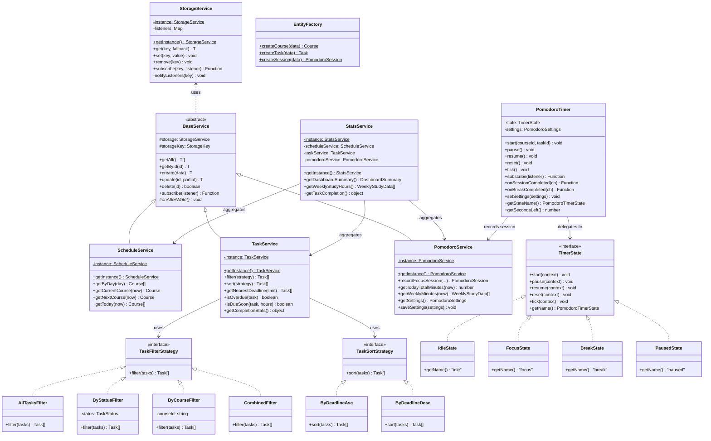
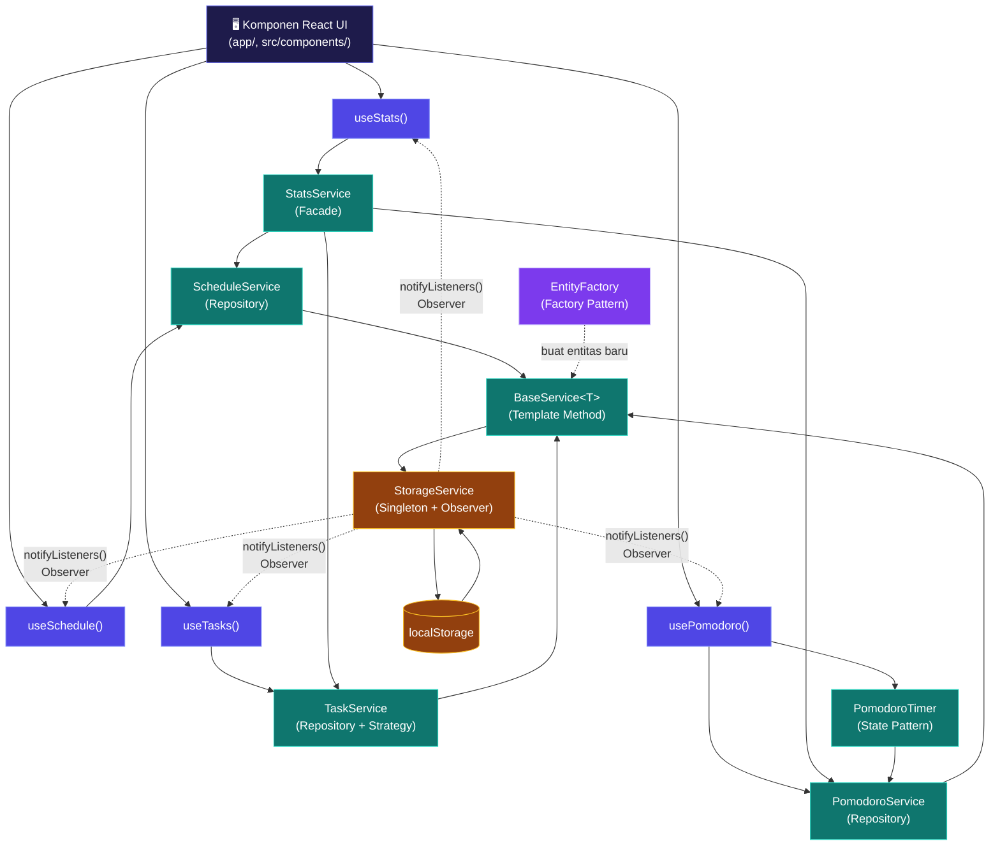

# 🏗️ Dokumentasi Arsitektur StudyTrack

> Versi: 1.0.0 | Stack: Next.js 16 (App Router) + TypeScript + Tailwind CSS + Recharts

---

## 1. Gambaran Arsitektur Berlapis

StudyTrack menggunakan **arsitektur berlapis ketat** (*strict layered architecture*) untuk memastikan setiap lapisan hanya berkomunikasi ke lapisan di bawahnya:

```
┌─────────────────────────────────────────────────────┐
│  LAYER 4 — Komponen React UI                        │
│  (app/, src/components/)                            │
│  → Tidak punya akses ke localStorage sama sekali    │
├─────────────────────────────────────────────────────┤
│  LAYER 3 — Custom Hooks                             │
│  (src/hooks/)                                       │
│  → Jembatan reaktif antara UI dan Service           │
├─────────────────────────────────────────────────────┤
│  LAYER 2 — Service Classes (OOP)                    │
│  (src/services/)                                    │
│  → Seluruh logika bisnis dan manipulasi data        │
├─────────────────────────────────────────────────────┤
│  LAYER 1 — StorageService (Singleton)               │
│  (src/services/StorageService.ts)                   │
│  → Satu-satunya pintu ke localStorage               │
└─────────────────────────────────────────────────────┘
```

---

## 2. Diagram Alur Data

### Alur Tulis (Create / Update / Delete)

```
Komponen React UI
      │  memanggil aksi (addTask, addCourse, dll.)
      ▼
Custom Hook (useTasks, useSchedule, usePomodoro, useStats)
      │  memanggil method service
      ▼
EntityFactory.createXxx()   ← membuat objek baru dengan UUID
      │
Service Class (TaskService, ScheduleService, PomodoroService)
  extends BaseService<T>    ← Repository + Template Method
      │  memanggil storage.set()
      ▼
StorageService.set(key, value)
      │  JSON.stringify + localStorage.setItem
      ▼
localStorage
      │  notifyListeners(key)   ← Observer Pattern
      ▼
Semua Hook yang subscribe → setState() → UI re-render otomatis
```

### Alur Baca (Read / Query)

```
Komponen React UI
      │  membaca state dari hook
      ▼
Custom Hook (state reaktif dari useState)
      │  diisi saat mount dan setiap perubahan
      ▼
Service Class → BaseService.getAll()
      │
StorageService.get(key, fallback)
      │  JSON.parse + localStorage.getItem
      ▼
localStorage
```

---

## 3. Design Patterns yang Digunakan

### 3.1 Singleton Pattern — `StorageService`

| Aspek | Detail |
|-------|--------|
| **File** | [`src/services/StorageService.ts`](../src/services/StorageService.ts) |
| **Alasan** | Memastikan hanya ada **satu instance** pengelola localStorage di seluruh aplikasi, menghindari race condition dan inkonsistensi data. |
| **Implementasi** | `private static instance: StorageService` + `public static getInstance()` |

**Komentar kode kunci:**
```typescript
// PATTERN: Singleton
private static instance: StorageService;
public static getInstance(): StorageService {
  if (!StorageService.instance) {
    StorageService.instance = new StorageService();
  }
  return StorageService.instance;
}
```

---

### 3.2 Observer Pattern — `StorageService.subscribe()`

| Aspek | Detail |
|-------|--------|
| **File** | [`src/services/StorageService.ts`](../src/services/StorageService.ts) |
| **Alasan** | Memungkinkan banyak hook / komponen **bereaksi otomatis** terhadap perubahan data tanpa polling. Cross-tab sync juga didukung via `window.addEventListener("storage", ...)`. |
| **Implementasi** | `Map<key, Set<Listener>>` + `notifyListeners()` dipanggil setiap `set()` / `remove()` |

**Komentar kode kunci:**
```typescript
// PATTERN: Observer — listener dipanggil setiap data pada key ini berubah
public subscribe<T>(key: StorageKey, listener: Listener<T>): () => void {
  // ...
  return () => set.delete(listener); // fungsi unsubscribe
}
private notifyListeners(key: StorageKey): void {
  const value = this.get(key, null);
  set.forEach((listener) => listener(value)); // notify all
}
```

---

### 3.3 Repository + Template Method — `BaseService<T>`

| Aspek | Detail |
|-------|--------|
| **File** | [`src/services/BaseService.ts`](../src/services/BaseService.ts) |
| **Alasan** | Menyediakan operasi CRUD generik (`getAll`, `getById`, `create`, `update`, `delete`, `subscribe`) yang dapat diwarisi oleh semua service tanpa duplikasi kode. Subclass hanya menambah logika domain-spesifik. |
| **Template Method** | `onAfterWrite?(): void` — hook opsional yang dapat di-override subclass |

**Hierarki pewarisan:**
```
BaseService<T>
  ├── ScheduleService  (extends BaseService<Course>)
  ├── TaskService      (extends BaseService<Task>)
  └── PomodoroService  (extends BaseService<PomodoroSession>)
```

---

### 3.4 Factory Pattern — `EntityFactory`

| Aspek | Detail |
|-------|--------|
| **File** | [`src/factories/EntityFactory.ts`](../src/factories/EntityFactory.ts) |
| **Alasan** | Memusatkan pembuatan objek entitas (Course, Task, PomodoroSession) dengan UUID otomatis dan nilai default yang valid, mencegah inkonsistensi data. |

**Komentar kode kunci:**
```typescript
// PATTERN: Factory — pembuatan entitas dengan ID unik terpusat
public static createTask(data: Omit<Task, "id" | "createdAt">): Task {
  return { id: crypto.randomUUID(), createdAt: new Date().toISOString(), ...data };
}
```

---

### 3.5 Strategy Pattern — Filter & Sort Tugas

| Aspek | Detail |
|-------|--------|
| **File** | [`src/services/strategies/TaskFilterStrategy.ts`](../src/services/strategies/TaskFilterStrategy.ts), [`TaskSortStrategy.ts`](../src/services/strategies/TaskSortStrategy.ts) |
| **Alasan** | Memisahkan algoritma filter dan sort dari `TaskService`, memungkinkan penambahan strategi baru tanpa mengubah kode yang ada (Open/Closed Principle). |

**Strategi tersedia:**
- Filter: `AllTasksFilter`, `ByStatusFilter`, `ByCourseFilter`, `CombinedFilter`
- Sort: `ByDeadlineAsc`, `ByDeadlineDesc`

```typescript
// PATTERN: Strategy — algoritma filter dapat diganti runtime
interface TaskFilterStrategy { filter(tasks: Task[]): Task[]; }
class ByStatusFilter implements TaskFilterStrategy {
  filter(tasks: Task[]) { return tasks.filter(t => t.status === this.status); }
}
```

---

### 3.6 State Pattern — Pomodoro Timer

| Aspek | Detail |
|-------|--------|
| **File** | [`src/services/PomodoroTimer.ts`](../src/services/PomodoroTimer.ts) |
| **Alasan** | Timer Pomodoro memiliki 4 state berbeda (`Idle → Focus → Break → Idle`) dengan transisi yang jelas. State Pattern mencegah logika `if-else` yang rumit dan memastikan transisi valid. |

**Mesin state:**
```
Idle ──start()──► Focus ──selesai──► Break ──selesai──► Idle
       ◄──reset()──       pause()↕resume()   pause()↕resume()
```

**State yang diimplementasikan:**
- `IdleState` — timer tidak berjalan
- `FocusState` — countdown sesi fokus aktif
- `BreakState` — countdown istirahat aktif
- `PausedState` — timer dijeda (dari focus atau break)

---

### 3.7 Facade Pattern — `StatsService`

| Aspek | Detail |
|-------|--------|
| **File** | [`src/services/StatsService.ts`](../src/services/StatsService.ts) |
| **Alasan** | Dashboard membutuhkan data dari 3 service (Schedule, Task, Pomodoro) sekaligus. Facade menyederhanakan ini menjadi satu panggilan `getDashboardSummary()`. |

```typescript
// PATTERN: Facade — satu pintu untuk data dashboard dari banyak service
public getDashboardSummary(): DashboardSummary {
  return {
    todaySchedule: this.scheduleService.getToday(now),
    currentCourse: this.scheduleService.getCurrentCourse(now),
    taskStats:     this.taskService.getCompletionStats(),
    todayMinutes:  this.pomodoroService.getTodayTotalMinutes(now),
    // ...
  };
}
```

---

## 4. Diagram Class UML (Mermaid)



---

## 5. Diagram Alur Data Lengkap (Mermaid)



---

## 6. Struktur Folder

```
src/
├── types/
│   └── index.ts            # Semua interface + konstanta STORAGE_KEYS
├── factories/
│   └── EntityFactory.ts    # Factory Pattern — pembuatan entitas
├── services/
│   ├── StorageService.ts   # Singleton + Observer
│   ├── BaseService.ts      # Repository + Template Method
│   ├── ScheduleService.ts  # Domain: jadwal kuliah
│   ├── TaskService.ts      # Domain: manajemen tugas
│   ├── PomodoroService.ts  # Domain: sesi pomodoro
│   ├── PomodoroTimer.ts    # State Pattern: mesin timer
│   ├── StatsService.ts     # Facade Pattern
│   ├── NotificationUtils.ts
│   └── strategies/
│       ├── TaskFilterStrategy.ts   # Strategy: filter tugas
│       └── TaskSortStrategy.ts     # Strategy: sort tugas
├── hooks/
│   ├── useSchedule.ts      # Hook jadwal (Observer + CRUD)
│   ├── useTasks.ts         # Hook tugas (Observer + Strategy)
│   ├── usePomodoro.ts      # Hook timer (State + Observer)
│   └── useStats.ts         # Hook statistik (Facade + Observer)
└── components/
    ├── layout/
    │   ├── Sidebar.tsx
    │   └── TopBar.tsx
    ├── dashboard/
    │   ├── ScheduleCard.tsx
    │   ├── DeadlineCard.tsx
    │   ├── StudyStatsCard.tsx
    │   ├── TaskProgressCard.tsx
    │   ├── QuickActions.tsx
    │   └── index.ts
    ├── charts/
    │   ├── MiniChart.tsx
    │   ├── StudyHoursBarChart.tsx
    │   ├── TaskCompletionPieChart.tsx
    │   └── index.ts
    ├── schedule/
    ├── tasks/
    └── pomodoro/

app/
├── page.tsx           # Dashboard (useStats, useSchedule, useTasks, usePomodoro)
├── schedule/page.tsx  # Halaman jadwal kuliah
├── tasks/page.tsx     # Halaman manajemen tugas
├── pomodoro/page.tsx  # Halaman Pomodoro timer
└── progress/page.tsx  # Halaman grafik & statistik
```

---

## 7. Kunci localStorage

| Kunci | Tipe Data | Deskripsi |
|-------|-----------|-----------|
| `studytrack:schedule` | `Course[]` | Daftar jadwal kuliah mingguan |
| `studytrack:tasks` | `Task[]` | Daftar semua tugas |
| `studytrack:pomodoro` | `PomodoroSession[]` | Riwayat sesi fokus |
| `studytrack:pomodoro-settings` | `PomodoroSettings` | Pengaturan durasi timer |

---

## 8. Skenario Demo (Urutan Klik untuk Presentasi)

### Demo 1 — Alur Lengkap: Jadwal → Tugas → Pomodoro → Dashboard

```
1. Buka http://localhost:3000
   → Dashboard kosong (empty state) — tampil gambar kosong yang rapi

2. Klik "📅 Jadwal" di sidebar
   → Tambah mata kuliah: "Pemrograman Web", Senin 08:00–09:40, Ruang 301, warna biru
   → Klik "Simpan" → jadwal muncul di tabel
   → Kembali ke Dashboard → kartu "Jadwal Hari Ini" terupdate otomatis (Observer)

3. Klik "✅ Tugas" di sidebar
   → Tambah tugas: "Laporan Praktikum", deadline besok, prioritas Tinggi
   → Status: "Belum Selesai"
   → Kembali ke Dashboard → "Deadline Terdekat" menampilkan tugas dengan label merah/kuning

4. Klik "🍅 Pomodoro" di sidebar
   → Pilih mata kuliah dari dropdown
   → Klik "Mulai Fokus" → countdown 25:00 berjalan (State: Idle → Focus)
   → Tunggu 5 detik → Klik "Pause" → State: Paused
   → Klik "Lanjutkan" → State: Focus
   → Tunggu timer selesai (atau set settings 1 menit untuk demo)
   → Notifikasi "Sesi fokus selesai!" muncul → State: Break

5. Kembali ke Dashboard
   → "Belajar Hari Ini" terupdate dengan menit yang dicatat
   → MiniChart sparkline berubah

6. Klik "📈 Progres" di sidebar
   → Bar chart jam belajar 7 hari tampil
   → Donut chart tugas selesai vs belum tampil

7. Ubah status tugas dari "Belum" → "Selesai"
   → Kembali ke Dashboard → progres task naik otomatis (Observer)
```

### Demo 2 — Reaktivitas Observer Pattern

```
1. Buka dua tab browser: satu di /tasks, satu di /
2. Di tab /tasks, tambah tugas baru
3. Pindah ke tab Dashboard — kartu deadline langsung terupdate
   (Cross-tab Observer via window.addEventListener("storage", ...))
```

### Demo 3 — Empty State

```
1. Buka aplikasi fresh (atau hapus localStorage)
2. Dashboard menampilkan semua empty state yang rapi
3. Klik Quick Action "Mulai Pomodoro" — navigasi ke halaman Pomodoro
```

---

## 9. Pembagian Tugas Tim

| Anggota | Branch | Kontribusi |
|---------|--------|------------|
| **Ariq** | `feat_arsitektur_core`, `feat_jadwal_kuliah`, `feat_manajemen_tugas`, `feat_dashboard_ui` | Core architecture (Singleton, Observer, Repository, Factory, Strategy, Facade), Jadwal kuliah, Manajemen tugas, Layout dasar |
| **Isra** | `feature/pomodoro`, `feat_progress_charts` | Pomodoro timer (State Pattern), hook usePomodoro, halaman progress, MiniChart, StudyHoursBarChart, TaskCompletionPieChart |
| **Riyadh** | `feature/dashboard`, `docs/architecture`, `chore/final-integration` | Dashboard page (4 hook + komponen modular), dokumentasi arsitektur, integrasi & QA akhir |

---

*Dokumentasi ini ditulis oleh: **Riyadh** (Tahap Dokumentasi Arsitektur)*
*Terakhir diperbarui: 13 Oktober 2026*
